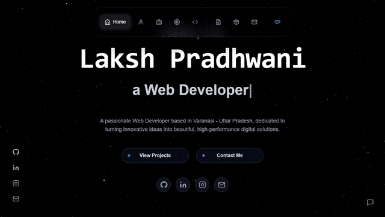
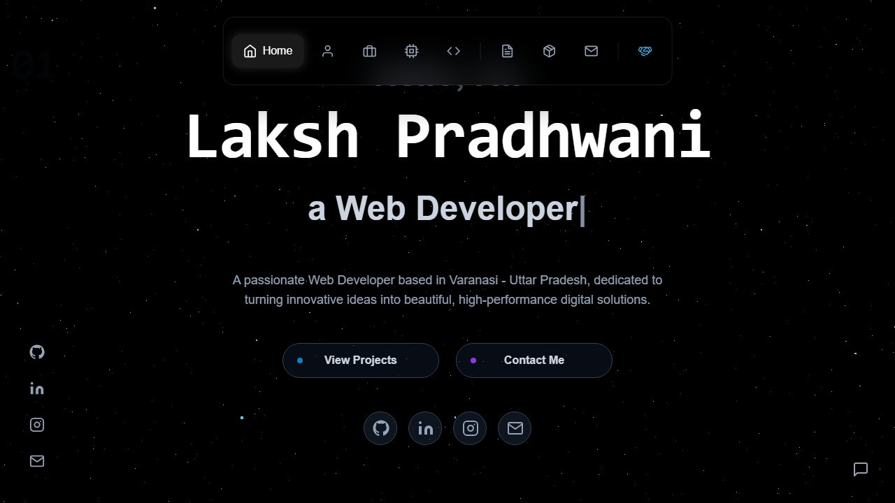
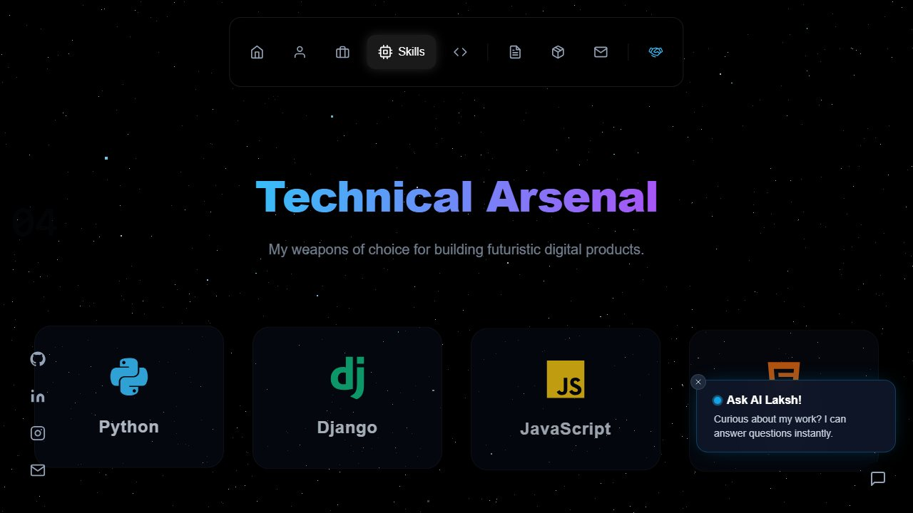
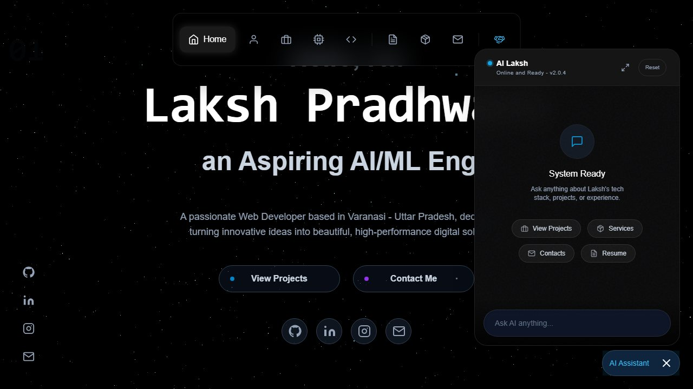

<div align="center">


<br>


<br>

[Live site](https://lakshpradhwani.com) &nbsp;/&nbsp; [Hire page](https://lakshpradhwani.com/hire) &nbsp;/&nbsp; [The tour](#the-tour) &nbsp;/&nbsp; [Architecture](#architecture) &nbsp;/&nbsp; [Run it](#run-it-locally) &nbsp;/&nbsp; [Structure](#project-structure)

</div>

<br>

A dark, cinematic developer portfolio that feels like a product rather than a page: a star field you drift through, a typed headline, a floating pill navigation, live repository cards, a priced **/hire** page for clients and **AI Laksh**, a chat assistant that answers from real facts about Laksh.

This is the site that [lakshpradhwani.com](https://lakshpradhwani.com) serves today. The next version, an illustrated valley you fly into by scrolling, lives in [Portfolio-V2](https://github.com/TheRealLaksh/Portfolio-V2).

<br>



<p align="center"><sub>Real screen recording of the live site: hero, about, skills, projects and contact.</sub></p>

<br>


<br>


## The tour

<table>
<tr>
<td width="50%"></td>
<td width="50%"></td>
</tr>
<tr>
<td align="center"><sub>Hero: typed roles cycle through "a Web Developer", "an Aspiring AI/ML Engineer" and "a Passionate Learner"</sub></td>
<td align="center"><sub>Skills: the "Technical Arsenal"</sub></td>
</tr>
</table>

| Section | What is in it |
|---|---|
| **Home** | Preloader intro (skipped for reduced motion and on other pages), typed headline, social links, a Three.js star field that reacts as you scroll |
| **About** | A character-card style intro with a playful "system check" panel |
| **Experience** | Internships and roles from a single data file (`timelineData.js`) |
| **Skills** | The Technical Arsenal: tool cards with brand colours from `skillsData.js` |
| **Projects** | Repository cards fetched live from the GitHub API and cached for an hour, with live-site and code buttons |
| **Resume** | Resume download |
| **Services** | The three packages, shared with the /hire page through one file, `packages.js` |
| **Contact** | Contact details and a form |

Navigation is a floating pill on desktop and a bottom dock on phones, both driven by the same scroll-spy hook. Section links work from any page, including `/#hash` deep links.


## The /hire page

A page for clients, not recruiters: a short intro with WhatsApp and email actions, three priced packages, recent work, the stack, and a three-step "how it starts". It has its own title, description, canonical URL and structured data, written into `dist/hire/index.html` at build time by a small Vite plugin, so search engines and link previews see /hire as its own page instead of a copy of the home page.

| Package | From |
|---|---|
| Business Website + CMS | Rs 30,000 |
| AI Features + Automation | Rs 55,000 |
| Custom Web App | Rs 75,000 |


## AI Laksh, the chat

A floating assistant that answers questions about Laksh and his work from a fixed set of facts. It has quick actions for projects, services, contacts and the resume, a contact card, a Reset button and a message history kept in the browser. The brain is a separate Express service on its own Vercel project, so no AI key ever ships in this site.

<p align="center"></p>


## Architecture


The site is a static Vite build on Vercel. Everything dynamic happens in the browser against public APIs: the GitHub REST API for the project cards, the Last.fm API for a "now playing" chip in the footer (shown only while a track is playing), and the chat backend for AI Laksh.

## Tech stack


## Details that took care

- **SEO that is honest per page.** Own head tags and JSON-LD for `/hire`, a `sitemap.xml`, `robots.txt`, canonical and social tags, and a no-JavaScript fallback.
- **Installable.** A web manifest and a service worker; the home page registers it and caches the shell for offline use.
- **Keyboard and screen readers.** A skip link that is the first tab stop, real buttons instead of clickable divs, and landmark roles. A Playwright and axe-core pass was run on the live site in October 2026.
- **Motion that respects people.** Reduced-motion visitors skip the preloader and get calmer animation; the chat teaser appears once per session and goes away by itself so it never sits on top of content.
- **Haptics.** Small vibration taps on touch devices for chat actions.

## Run it locally

```bash
git clone https://github.com/TheRealLaksh/Portfolio-V1.git
cd Portfolio-V1
npm install
npm run dev
```

Vite prints the address (usually `http://localhost:5173`). Use `npm run build` for a production build and `npm run preview` to serve it.

<details>
<summary><b>Environment variables</b></summary>

<br>

| Variable | What it does |
|---|---|
| `VITE_CHAT_API_URL` | Address of the chat backend. Optional: the code falls back to the deployed one. Accepts the bare address or the full `/api/chat` URL. |
| `VITE_LASTFM_USERNAME`, `VITE_LASTFM_API_KEY` | Last.fm account and a read-only key for the footer's "now playing" chip. |

Put local values in `.env` (ignored by git). Anything prefixed `VITE_` ends up in the browser bundle, so never put a secret in one.

</details>

## Project structure

```text
.
├── public/                 icons, manifest, service worker, sitemap, robots, link-preview image
├── scripts/readme/         regenerates the animated SVGs in this README
├── src/
│   ├── components/
│   │   ├── sections/       01-Hero ... 08-Contact
│   │   ├── layout/         Navbar, MobileNavbar, Footer, SocialSidebar, ScrollManager
│   │   ├── 3d/             the Three.js star field
│   │   ├── chat/           the AI Laksh window
│   │   └── ui/             Preloader, Reveal, Spotlight, PackageCard, TextReveal ...
│   ├── pages/              Home, Hire
│   ├── data/               packages, skills, timeline, section list, per-route metadata
│   ├── hooks/              GitHub repos, Last.fm, scroll spy, section navigation, page meta
│   └── utils/              haptics, class names, warp effect
├── docs/readme/            images and recordings used here
├── vercel.json             short links (/resume, /github, /linkedin ...) and SPA rewrites
└── vite.config.js          also writes dist/hire/index.html with /hire's own head
```

## Where it goes next

The valley redesign was first built on branches of this repository and now has its own home in [Portfolio-V2](https://github.com/TheRealLaksh/Portfolio-V2). This repository stays as the live classic site until that one launches.

## Credits and rights

Designed, written and built by [Laksh Pradhwani](https://lakshpradhwani.com). No open-source licence is attached to this repository, so please ask before reusing the code.

<br>


<sub>The animated graphics above are generated by <code>scripts/readme/build-assets.mjs</code>. The recording and screenshots are captured from the live site.</sub>
