<div align="center">


<br>


<br>

[The valley](#the-valley) &nbsp;/&nbsp; [The journey](#the-journey) &nbsp;/&nbsp; [The work crate](#the-work-crate) &nbsp;/&nbsp; [AI Laksh](#ai-laksh-the-chat) &nbsp;/&nbsp; [Architecture](#architecture) &nbsp;/&nbsp; [Run it](#run-it-locally) &nbsp;/&nbsp; [Structure](#project-structure)

</div>

<br>

A portfolio that behaves like a small illustrated world. You land in a painted river valley, scroll to fly into it, click the places to read the story behind them, ride a train through eight stops of a journey, open a crate of real projects, and ask **AI Laksh**, a chat that answers only from facts about Laksh and says so when it does not know.

It is the second version of [lakshpradhwani.com](https://lakshpradhwani.com). The first, a dark cinematic site, lives on as [Portfolio-V1](https://github.com/TheRealLaksh/Portfolio-V1) and is what the domain serves today. This repository is the next one, built and tested but **not launched yet**.

<br>

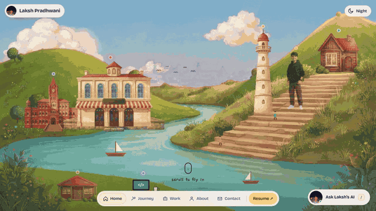

<p align="center"><sub>Real screen recording. Scrolling drives the camera: the valley opens, the clouds part and the story section arrives.</sub></p>

<br>


<br>


## The valley

The first screen is a painted scene made of separate layers: sky, far town, valley, buildings, clouds and foreground leaves. Each place is a pin you can click, and a sheet opens with the real story: ShiftsDeal, Masters' Union, the internships, an earlier chapter, and a pin that starts the music. Laksh stands on the steps, drawn from his own avatar.

One switch turns the whole valley from day to night: the sky swaps for a starry one with a moon, the windows glow and the page palette changes with it.

<table>
<tr>
<td width="50%">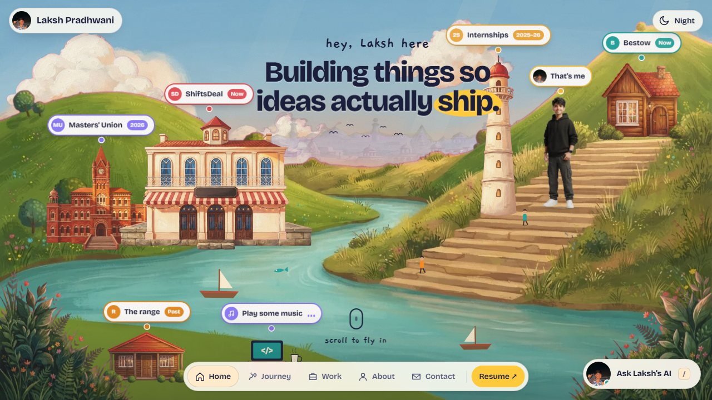</td>
<td width="50%">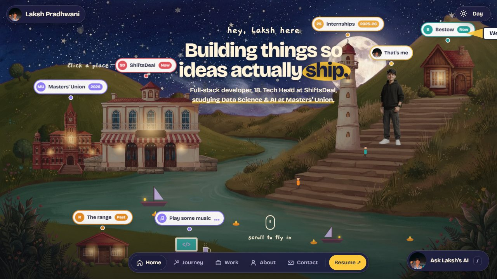</td>
</tr>
<tr>
<td align="center"><sub>Day</sub></td>
<td align="center"><sub>Night</sub></td>
</tr>
</table>

<details>
<summary><b>How the art was made</b></summary>

<br>

The scene art is painted with AI image models (Figma's `generate_image`, 16 images) on a flat magenta background, then keyed out with `scripts/art/process.py` and `valley.py` into transparent `.webp` layers in `public/art`. The layout lives in `src/world/Painted.jsx` and the pins and hot zones in `src/world/Hero.jsx`. The recipe, prompts and the script requirements are in [`scripts/art/README.md`](scripts/art/README.md). Setting `PAINTED = false` in `Hero.jsx` brings back the older hand-built SVG valley.

</details>


## The journey

Scroll becomes a train ride. The page pins a painted landscape and the train pulls into **eight stops**, one per chapter of Laksh's path. At each stop a window opens, a ticket spins out and unfolds into a card, the card is stamped, and the stamp flies to a passport strip at the bottom. The whole sequence is scroll-scrubbed, so you can stop, reverse or skim.

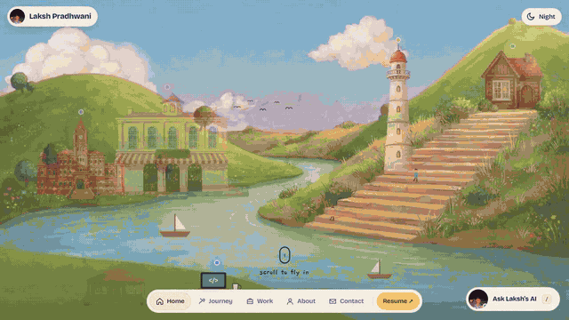

<p align="center"><sub>Real screen recording of the journey section.</sub></p>

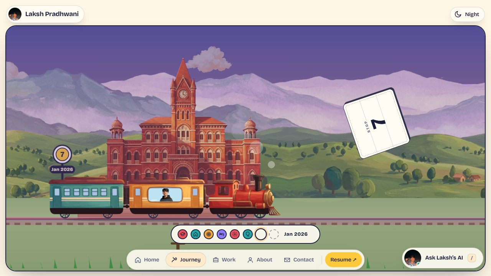


## The work crate

A cardboard crate holds six real projects, each with its own card. Filter by **All, Live sites** or **Open source**, open a card for the year, role, status and stack, step through with previous and next, copy a deep link (`/#work/<id>`), or use the keyboard: focusing a project in the list opens the crate and fast-forwards the scroll. The popup traps focus, locks page scroll while open and sits above the pinned section.

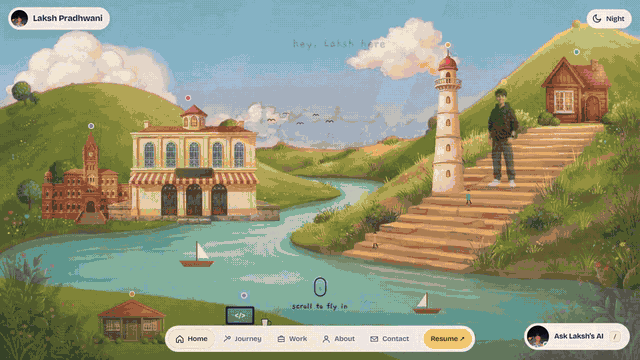

<table>
<tr>
<td width="50%">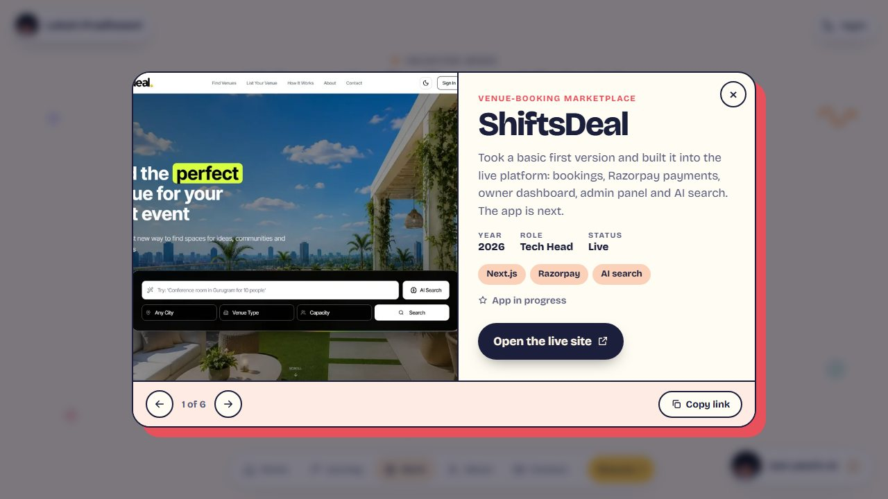</td>
<td width="50%">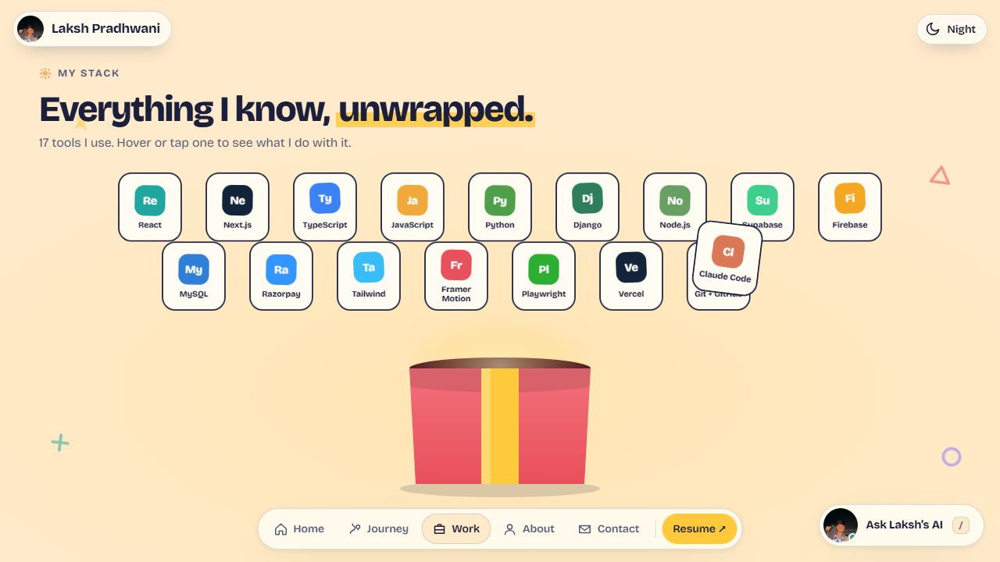</td>
</tr>
<tr>
<td align="center"><sub>Project popup with a real screenshot</sub></td>
<td align="center"><sub>Seventeen tools, unwrapped on scroll</sub></td>
</tr>
</table>


## About, process and the board

Below the work: a short section on how Laksh ships (smallest useful thing, then keep going), and an "off the clock" corkboard with polaroids and sticky notes you can drag around. The vinyl on the board is draggable too; a drag does not toggle the music, a click does.

<table>
<tr>
<td width="50%">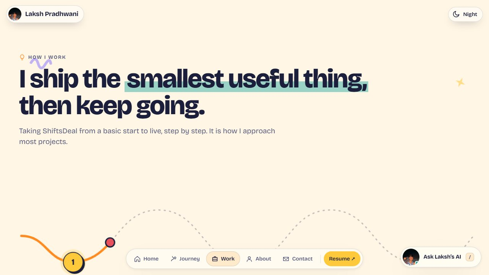</td>
<td width="50%">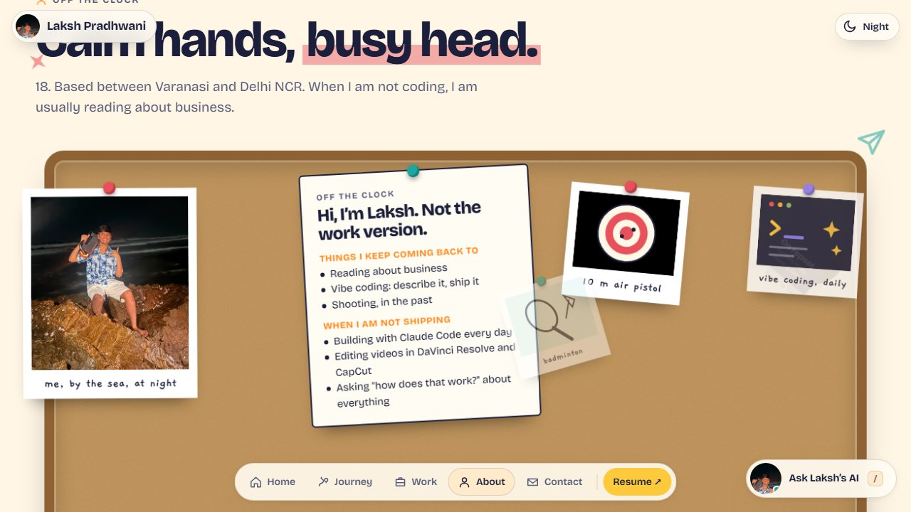</td>
</tr>
</table>

The page ends with a guestbook wall (notes are stored in Redis when it is configured; without it the wall shows a friendly "warming up" note) and a row of big keys that also work on the keyboard: <kbd>M</kbd> mail, <kbd>I</kbd> Instagram, <kbd>L</kbd> LinkedIn, <kbd>T</kbd> talk (WhatsApp until a booking link exists) and <kbd>R</kbd> resume.


## AI Laksh, the chat

Press <kbd>/</kbd> anywhere or tap the launcher. AI Laksh is a small assistant with one job: answer questions about Laksh from a fixed set of facts. It never invents prices, clients or links, it says when it does not know, and it refuses homework, code and prompt tricks.

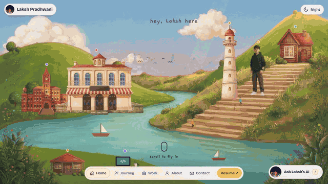

<p align="center"><sub>Real recording against the real backend: a starter question, a pricing card, then a follow-up chip.</sub></p>

<table>
<tr>
<td width="50%">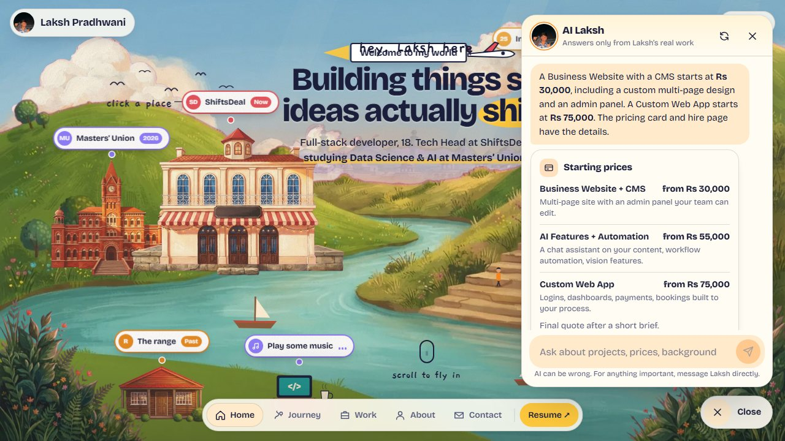</td>
<td width="50%">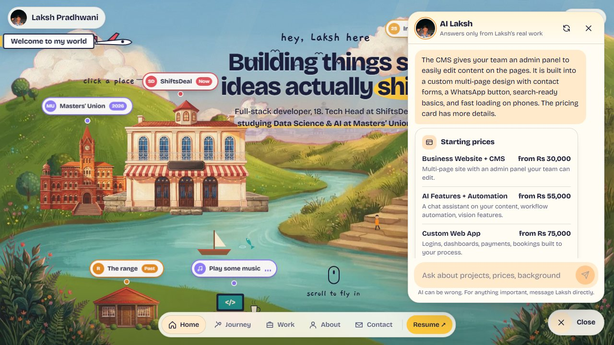</td>
</tr>
</table>

<table>
<tr>
<td width="50%">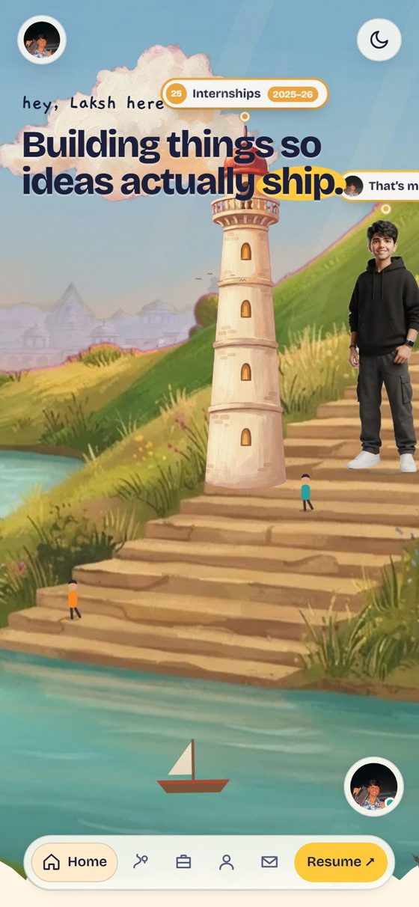</td>
<td width="50%">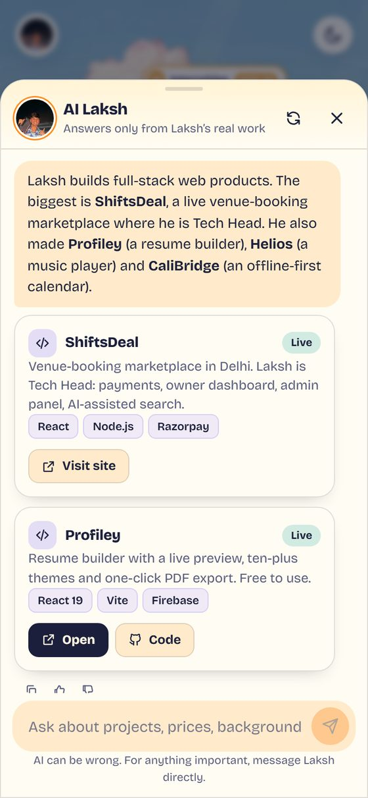</td>
</tr>
<tr>
<td align="center"><sub>Phone: launcher clears the nav pill</sub></td>
<td align="center"><sub>Phone: the chat becomes a bottom sheet</sub></td>
</tr>
</table>

**What the window does**

- Answers come back as text plus **cards** (contact, pricing, project, links) drawn from data the server owns, and two or three **follow-up chips** to tap next.
- The browser keeps the conversation (24 hours, in `localStorage`) and sends its last turns with each question, so the server stays stateless.
- Copy a reply, give it a thumbs up or down, start a new chat, retry a failed question in one tap.
- A rate-limit or outage shows a plain message and the contact card, never a dead end.
- It follows the valley's day and night colours, lives inside the same `.w-root` as the page, and is lazy-loaded.
- Keyboard: <kbd>/</kbd> opens, <kbd>Esc</kbd> closes, <kbd>Enter</kbd> sends, <kbd>Shift</kbd>+<kbd>Enter</kbd> adds a line, focus returns to the launcher on close. Replies are announced through an `aria-live` log.

### How a question travels

The window is the front of a separate service (the private repo `Portfolio-Chat_Bot`, an Express app on its own Vercel project). Every question passes four layers before an answer leaves:

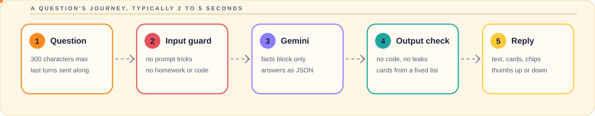

| Layer | What it does |
|---|---|
| Input guard | Rejects prompt injection, homework, code and sums before any AI call, so no quota is spent. Real hiring questions such as "what are his fees?" pass. |
| Gemini | Answers only from the facts block and replies as JSON: text, card ids and follow-up questions. Cheapest model first, then two fallbacks, optional Groq after that. |
| Output check | Drops code, leaked prompt text and over-long replies. Card ids must exist in a fixed catalogue, so a card can never carry an invented link. |
| Reply | Text, cards and chips reach the browser. A thumbs up or down is logged for the owner; unanswered questions show up as gaps to fill. |


## Architecture


The valley itself is a static Vite build. Two small serverless functions (`api/wall.js`, `api/visit.js`) share an Upstash Redis store for the guestbook and the daily visitor counter; without the store the counter hides and the wall shows a placeholder. The chat talks to its own backend, so the site never holds an AI key.

## Tech stack


## Care for people and devices

- **Reduced motion.** The scroll-scrubbed scenes switch off for visitors who ask for it, and the page falls back to a plain, readable layout. The scrub mode itself needs a landscape window at least 720 px wide and 420 px high, so small and short screens get the flat version.
- **Keyboard.** Skip link, visible focus rings, focus traps in the popups, a keyboard path to every project, and no interaction that needs a mouse.
- **Phones.** Bottom-sheet chat, launcher above the nav pill, popups that keep clear of the bottom bar.
- **Left out on purpose:** a custom cursor, word-by-word scroll text, and any scroll hijacking beyond the hero fly-in.

## Run it locally

```bash
git clone https://github.com/TheRealLaksh/Portfolio-V2.git
cd Portfolio-V2
npm install
npm run dev
```

Open the address Vite prints (usually `http://localhost:5173`). The build and preview commands are `npm run build` and `npm run preview`.

<details>
<summary><b>Environment variables</b></summary>

<br>

| Variable | Where | What it does |
|---|---|---|
| `VITE_CHAT_API_URL` | browser build | Address of the chat backend. Optional: the code falls back to the deployed backend. Accepts the bare address or the full `/api/chat` URL. |
| `UPSTASH_REDIS_REST_URL`, `UPSTASH_REDIS_REST_TOKEN` | serverless | Redis store for the guestbook wall and the visitor counter. Vercel's `KV_REST_API_URL` and `KV_REST_API_TOKEN` work too. Without them the wall and counter hide. |
| `WALL_ADMIN_TOKEN` | serverless | Lets the owner remove a wall note. |
| `VITE_LASTFM_USERNAME`, `VITE_LASTFM_API_KEY` | browser build | Only for the older `/classic` page's "now playing" card. |

Never commit real values. `.env` is ignored.

</details>

<details>
<summary><b>Routes</b></summary>

<br>

| Route | What it is |
|---|---|
| `/` | The valley |
| `/hire` | Client page with three priced packages, recent work and a three-step "how it starts" |
| `/book` | Booking page. Until a real booking link is set in `ME.book`, its buttons open WhatsApp |
| `/classic` | The earlier dark layout, kept for reference |
| `/lab/avatar` | Unlinked page for comparing avatar looks |

Short links in `vercel.json`: `/resume`, `/cv`, `/github`, `/linkedin`, `/instagram`.

</details>

## Project structure

```text
.
├── api/                    serverless: wall.js, visit.js, _redis.js
├── public/                 art/ (painted layers), work/ (screenshots), audio/, icons
├── scripts/
│   ├── art/                how the painted valley art was produced
│   └── readme/             regenerates the animated SVGs in this README
├── src/
│   ├── world/              the valley: Hero, Story, Journey, Work, Stack, Process, Life, Wall, Hello ...
│   ├── chat/               AI Laksh: Chat, useAsk, api, Message, Cards, chat.css
│   ├── components/         the /classic layout and shared UI
│   ├── pages/              Home, Hire
│   ├── data/               packages, route metadata
│   └── hooks/              scroll, page meta, GitHub and Last.fm data
├── docs/readme/            the images and recordings used here
└── vite.config.js          also prerenders /hire with its own head tags
```

## Roadmap

- Connect a real booking link (Google Calendar appointment schedule) and turn the `/book` buttons into it.
- Give the wall and visitor counter their Redis store in production.
- Two written case studies on the `/hire` page.
- Launch: connect this repository to Vercel, move `lakshpradhwani.com` over, and retire the older site's route.

## Credits and rights

Designed, written and built by [Laksh Pradhwani](https://lakshpradhwani.com). Scene art was painted with AI image models and processed by the scripts in `scripts/art`. The track in the "play some music" scene is *Sunroof* by Nicky Youre and dazy; its rights belong to the artists. No open-source licence is attached to this repository, so please ask before reusing the code or the art.

<br>

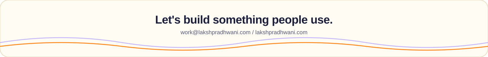

<sub>The animated graphics above are generated by <code>scripts/readme/build-assets.mjs</code>. The recordings and screenshots are captured from the running site.</sub>
